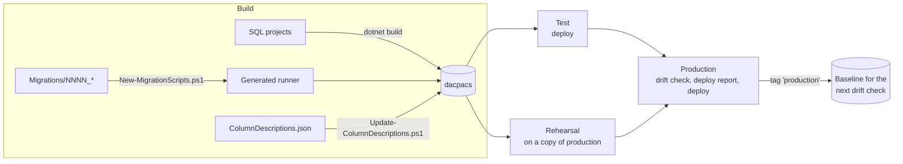

# Azure SQL database as code — a working playbook

Schema, data migrations, seed data and column descriptions for an Azure SQL database, kept in SQL
projects, built into dacpacs with `dotnet build` and deployed per environment with SqlPackage — with
a deploy report before every change, a block on data loss, a drift check and a rehearsal on a copy of
production. Sample SQL projects, PowerShell scripts tested with Pester against fakes, Azure DevOps
pipeline templates, and documentation that explains each design decision and how to apply it to your
own solution.



## Why

Publishing a dacpac takes one command. Changing a production database safely with it, release after
release, takes more, because:

- **a declarative model cannot express everything.** A rename becomes a drop and an add; a backfill, a
  split or a guarded drop has no place in a `CREATE TABLE`;
- **the defaults are not the safe ones.** Without the right profile SqlPackage rebuilds tables, adds
  smart defaults to `NOT NULL` columns, or drops the users the platform created;
- **seed data is not one thing.** Reference data, per-environment configuration and test data need
  different rules, and test data must never reach production;
- **test data is not production data.** A change that deploys on test can block, or run for an hour, on
  rows that only production has;
- **change data capture does not follow a schema change.** A wider captured column deploys fine and stops
  the capture; the transaction log then grows until the database stops accepting writes;
- **people change databases by hand.** Nobody notices until the next deployment undoes it.

This playbook covers those cases.

## What it shows

| Topic | Read | See it in code |
|---|---|---|
| Eight projects, one job each, and the order they are deployed in | [how-it-works.md](docs/how-it-works.md) | [build.proj](database/build.proj), [environments.json](database/environments.json) |
| Declarative changes and scripted migrations, tracked by id, generated runner | [migrations.md](docs/migrations.md) | [Migrations.ps1](scripts/lib/Migrations.ps1), [Shop.Database.Migrations](database/Shop.Database.Migrations) |
| Renames, `NOT NULL` and drops in several releases (expand and contract) | [breaking-changes.md](docs/breaking-changes.md) | [0002_RenameCustomerEmail](database/Shop.Database.Migrations/Migrations/0002_RenameCustomerEmail/01_Rename.sql) |
| Reference data, configuration per environment, test data, DropAll | [seed-data-and-environments.md](docs/seed-data-and-environments.md) | [Shop.Database.ReferenceData](database/Shop.Database.ReferenceData), [seed-configuration](database/seed-configuration) |
| Column descriptions as extended properties, checked against the dacpac; data classification | [column-descriptions-and-data-classification.md](docs/column-descriptions-and-data-classification.md) | [ColumnDescriptions.ps1](scripts/lib/ColumnDescriptions.ps1), [Dacpac.ps1](scripts/lib/Dacpac.ps1) |
| Change data capture and schema changes, the transaction log, monitoring | [cdc-and-schema-changes.md](docs/cdc-and-schema-changes.md) | [Cdc.ps1](scripts/lib/Cdc.ps1), [monitoring-queries.sql](database/cdc/monitoring-queries.sql) |
| Build, deploy report, data-loss and rebuild blockers, drift, the publish profile | [pipeline-and-deployment.md](docs/pipeline-and-deployment.md) | [Deployment.ps1](scripts/lib/Deployment.ps1), [Shop.Database.publish.xml](database/publish/Shop.Database.publish.xml), [pipelines](pipelines/database.yml) |
| Rehearse the release on a copy of production, with safety guards | [schema-rehearsal.md](docs/schema-rehearsal.md) | [Rehearsal.ps1](scripts/lib/Rehearsal.ps1), [rehearse-schema-update.yml](pipelines/templates/rehearse-schema-update.yml) |
| Index and statistics maintenance and cleanup outside the dacpac | [database-maintenance.md](docs/database-maintenance.md) | — |
| Rules and a skill for Copilot | [copilot-instructions.md](docs/copilot-instructions.md) | [database.instructions.md](.github/instructions/database.instructions.md), [SKILL.md](skill/SKILL.md) |

Then: [get started](docs/getting-started.md),
[apply it to your own solution](docs/applying-to-your-solution.md), and read the
[pitfalls](docs/pitfalls.md) first.

## Quick start

Requires the .NET 10 SDK, PowerShell 7.2+ and Pester 5.

```shell
dotnet build database/build.proj --configuration Release
pwsh -c "Invoke-Pester scripts/tests -Output Detailed"
pwsh ./scripts/New-MigrationScripts.ps1 -Check
pwsh ./scripts/Update-ColumnDescriptions.ps1 -Check -DacpacPath database/Shop.Database/bin/Release/Shop.Database.dacpac
```

The build writes one dacpac per project; the tests run every script against a fake Azure CLI and a fake
SqlPackage, so neither is needed. To deploy to a local SQL Server or to Azure SQL Database, plan with
`./scripts/Publish-Database.ps1 … -WhatIf` first. See [getting started](docs/getting-started.md).

## Layout

```text
database/
  Shop.Database/                 The schema: tables, views, schemas, column descriptions
  Shop.Database.Migrations/      Scripted data migrations and the generated runner
  Shop.Database.ReferenceData/   Seed data for every environment
  seed-configuration/            Configuration seed data, one project per environment
  Shop.Database.TestData/        Test data, for environments that allow it
  Shop.Database.DropAll/         Empties a development database, guarded
  publish/                       The publish profile of the schema dacpac
  cdc/                           Captured columns (owned elsewhere) and monitoring queries
  environments.json              Which projects each environment gets
scripts/
  *.ps1                          Entry scripts: generate, check, publish, rehearse
  lib/                           The logic, with one wrapper each for az and sqlpackage
  schemas/                       JSON schemas for the configuration files
  tests/                         Pester tests and the fakes
pipelines/                       Azure DevOps: build, deploy per environment, rehearsal
skill/                           A Copilot skill for database work
.githooks/                       A pre-commit hook that regenerates the generated files
tools/                           Leak check and documentation link check, run in CI
```

## Related playbooks

From the same monorepo, each on its own:

- [Azure App Configuration](https://github.com/iverburgh/azure-app-configuration-playbook) —
  configuration and feature flags as code, deployed per environment.
- [Renovate on Azure DevOps](https://github.com/iverburgh/renovate-azure-devops-playbook) —
  automated dependency updates, including the SQL project SDK.
- [Copilot on Azure DevOps](https://github.com/iverburgh/copilot-azure-devops-playbook) —
  instructions, skills and agents for a repository like this one.
- [Path filters on Azure DevOps](https://github.com/iverburgh/azure-devops-path-filter-playbook) —
  build and deploy only what a change touches, such as a database project.
- [Domain-Driven Design in .NET](https://github.com/iverburgh/ddd-dotnet-playbook) —
  bounded contexts, aggregates and domain events on top of a database like this one.
- [Entra ID app registrations as code](https://github.com/iverburgh/entra-app-registrations-as-code-playbook) —
  app registrations, roles and managed identities as code, such as the one that deploys the database.
- [Circuit breakers on Azure Functions](https://github.com/iverburgh/azure-functions-circuit-breaker-playbook) —
  a breaker shared by every instance, to pause processing while a dependency is down.
- [HTTP resilience in .NET](https://github.com/iverburgh/dotnet-http-resilience-playbook) —
  retries, timeouts and outbound throttling for HTTP calls.
- [OpenTelemetry observability in .NET](https://github.com/iverburgh/dotnet-opentelemetry-observability-playbook) —
  traces, metrics and logs with OpenTelemetry and Application Insights.
- [Service Bus settlement in Azure Functions](https://github.com/iverburgh/azure-functions-service-bus-settlement-playbook) —
  Service Bus message settlement in Azure Functions: complete, abandon or dead-letter.
- [Azure SQL disaster recovery](https://github.com/iverburgh/azure-sql-disaster-recovery-playbook) —
  a guided point-in-time restore of an Azure SQL database after a disaster.

## License

[MIT](LICENSE)
