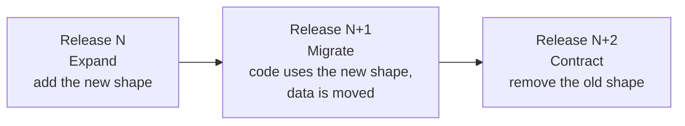

# Breaking changes: expand, migrate, contract

The application and the database are deployed separately, and for a while both versions of the
application run against one schema: during a rolling deployment, in a slot swap, when a deployment is
rolled back. So every schema change must work with the code that is running now **and** with the code
that comes next.

A change that removes or renames something the running code uses is therefore never one release. It is
three:

## Example: rename `Sales.Customer.Email` to `EmailAddress` without downtime

| Release | Database | Application |
|---|---|---|
| N — expand | Add `EmailAddress NULL`. | Writes both columns, reads `Email`. |
| N+1 — migrate | Migration: `UPDATE ... SET EmailAddress = Email WHERE EmailAddress IS NULL`. Make `EmailAddress NOT NULL`. | Reads and writes `EmailAddress`; still writes `Email` for the old version. |
| N+2 — contract | A guarded migration drops `Email`; remove it from the project. | Only `EmailAddress`. |

The sample takes a shortcut, [0002_RenameCustomerEmail](../database/Shop.Database.Migrations/Migrations/0002_RenameCustomerEmail/01_Rename.sql):
`sp_rename` in one release. That is fine when nothing reads the old name any more — a column that only a
batch job uses, or a system with a maintenance window. When the running application reads it, use the
three releases above.

## Example: a column becomes `NOT NULL`

[0001_BackfillOrderCurrency](../database/Shop.Database.Migrations/Migrations/0001_BackfillOrderCurrency/01_Backfill.sql)
shows the second half:

1. Release N added `Sales.Order.CurrencyCode` as `NULL`, and the application started to fill it.
2. Release N+1 fills the old rows in a migration, which runs before the schema, and the schema makes the
   column `NOT NULL`. Without the migration the publish stops: `ALTER COLUMN ... NOT NULL` fails on the
   `NULL` rows.

## Dropping a column or a table

`BlockOnPossibleDataLoss=True` in the [publish profile](../database/publish/Shop.Database.publish.xml)
stops any deployment that would drop a column or table with rows. That is the point: data loss is never a
side effect. Note what SqlPackage checks: for a dropped column it tests whether the *table* has any rows,
not whether the column holds values — emptying the column does not help. To really drop one:

1. Release N: no code reads or writes it any more.
2. Release N+1: a guarded migration drops it explicitly
   (`IF COL_LENGTH(N'Sales.Customer', N'Email') IS NOT NULL ALTER TABLE ... DROP COLUMN ...`, through
   `sp_executesql`), after copying what you still need. Remove it from the project in the same release.
   The migration runs before the schema, so the deploy report has nothing left to drop and does not
   block. The decision to lose the data is now a reviewed line of code instead of a side effect.

Check the deploy report of the plan step: it lists every drop. If it still says "data loss", something
else is being dropped — stop and find out what.

## Changes that rebuild a table

Some changes cannot be done with `ALTER TABLE`: changing the clustered key, `IDENTITY` on an existing
column, a column order change without `IgnoreColumnOrder`. SqlPackage then creates a new table, copies
every row and swaps the names. On a large table that locks it for the duration, fills the transaction log
and breaks change data capture on it.

The publish profile sets `AllowTableRecreation=False`, and the deploy script treats a `TableRebuild` in
the deploy report as a blocker. Do such a change by hand-written expand and contract: a new table,
copying in batches, a switch in the code, then dropping the old one.

## Checklist for a breaking change

- [ ] Does the running version of the application still work after this deployment?
- [ ] Does the previous version still work if the application is rolled back but the database is not?
- [ ] Is every `NOT NULL` preceded by a backfill migration?
- [ ] Is every drop preceded by a release in which nothing uses it, and done by a guarded migration?
- [ ] Does it touch a captured column? Then see [CDC and schema changes](cdc-and-schema-changes.md).
- [ ] Did the [schema rehearsal](schema-rehearsal.md) pass on a copy of production?
