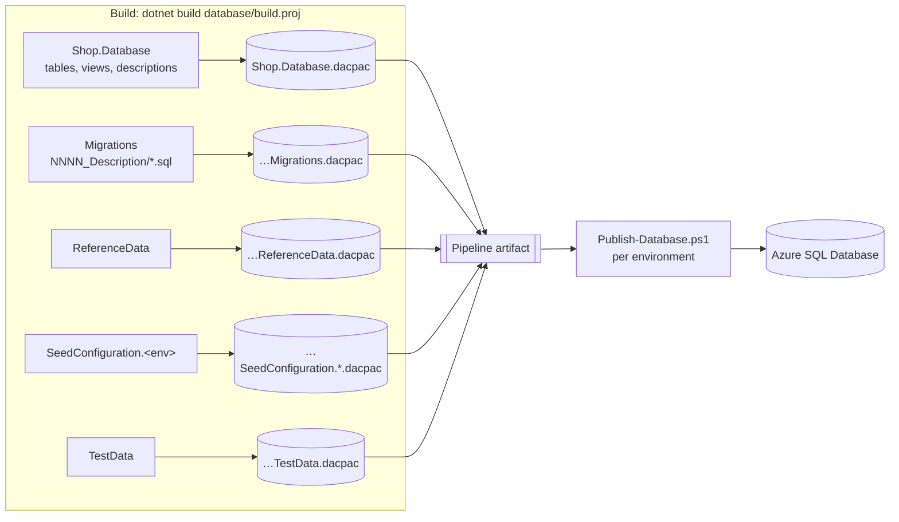

# How it works

The database is declared, not scripted. Each SQL project describes a desired state; the build turns it
into a `.dacpac` (a zip with the model and the deployment scripts), and SqlPackage compares that model
with a real database and generates the change script. Whatever a model cannot express — moving data,
renaming a column, filling a new column — is a small, numbered migration that runs exactly once.

## Eight projects, one job each

| Project | Contains | Published |
|---|---|---|
| `Shop.Database` | Schemas, tables, keys, indexes, views, column descriptions | Always, with the publish profile |
| `Shop.Database.Migrations` | Numbered data migrations and the generated runner | Always, **before** the schema |
| `Shop.Database.ReferenceData` | Rows the code depends on (statuses, categories) | Always |
| `Shop.Database.SeedConfiguration.<Env>` | Rows that differ per environment (endpoints, switches) | The one for the target environment |
| `Shop.Database.TestData` | Customers, products and orders to test with | Only where `testData` is true |
| `Shop.Database.DropAll` | A guarded script that empties a database | Only on request, where `allowDropAll` is true |

Only `Shop.Database` holds schema objects. The other projects have no model: their dacpac only carries a
post-deployment script. That keeps every concern separately deployable, and it means a seed or a
migration can never make SqlPackage drop a table — the deploy script also publishes them with
`DropObjectsNotInSource=False` and `ScriptDatabaseOptions=False`
([Deployment.ps1](../scripts/lib/Deployment.ps1)).

All projects use the SDK-style [`Microsoft.Build.Sql`](https://learn.microsoft.com/sql/tools/sql-database-projects/sql-database-projects)
project format, so `dotnet build` produces the dacpacs on Windows, Linux and macOS. Shared settings —
the target platform (Azure SQL Database), warnings as errors, the dacpac version — live in
[Directory.Build.props](../database/Directory.Build.props). [build.proj](../database/build.proj) builds
them all.

## Deployment order

[Publish-Database.ps1](../scripts/Publish-Database.ps1) publishes the steps in this order:

1. **DropAll** — only with `-DropAll` and only where the environment allows it.
2. **Migrations** — runs pending migrations on the database as it is, so data is ready for the new
   shape. On a new database it records every migration as already applied.
3. **Schema** — first a deploy report and a change script, then, when nothing blocks, the publish.
4. **ReferenceData** — `MERGE` statements on fixed keys.
5. **SeedConfiguration.&lt;env&gt;** — the configuration rows of that environment.
6. **TestData** — only where the environment has `testData`.

Why migrations before the schema: the schema dacpac refuses to lose data. If release 2 makes a column
`NOT NULL`, its old rows must be filled first; if it renames a column, the rename must happen before the
dacpac sees a "new" column and an "obsolete" one. See [migrations](migrations.md).

[environments.json](../database/environments.json) says what each environment gets, and a JSON schema
makes sure a `protected` environment can never get test data or a DropAll.

## Generated files

Two things are generated from a simpler source and committed:

| Source | Generated | By |
|---|---|---|
| `Migrations/NNNN_*/` folders | `Scripts/Generated/RunMigrations.sql`, `InitMigrations.sql` | [New-MigrationScripts.ps1](../scripts/New-MigrationScripts.ps1) |
| `ColumnDescriptions.json` | `Generated/ColumnDescriptions.sql` (extended properties) | [Update-ColumnDescriptions.ps1](../scripts/Update-ColumnDescriptions.ps1) |

Both scripts have a `-Check` switch that writes nothing and fails when the committed file differs from
what would be generated. CI, the sample pipeline and the [pre-commit hook](../.githooks/pre-commit) run
them that way, so a hand edit or a forgotten regeneration never reaches a database.

## Safety nets, from cheap to expensive

| Net | Catches | Where |
|---|---|---|
| Migration rules | `GO`, transactions, `USE`, CDC calls, duplicate variables in a migration | `New-MigrationScripts.ps1 -Check` |
| Description check | A new column without a description | `Update-ColumnDescriptions.ps1 -Check` |
| CDC column check | A change to a column that change data capture reads | `Test-CdcColumnChanges.ps1` (offline) |
| Deploy report | Possible data loss, a table rebuild | `Publish-Database.ps1` (before every schema publish) |
| Publish profile | Data loss, as a second line of defence | `BlockOnPossibleDataLoss=True` |
| Drift check | Changes made outside the pipeline | `Publish-Database.ps1 -DriftBaselineDacpac` |
| Schema rehearsal | Migrations that fail on real data; slow changes | `Invoke-SchemaRehearsal.ps1` on a copy of production |

## Scripts and tests

Every script under [scripts/](../scripts) dot-sources the libraries in [scripts/lib](../scripts/lib).
All calls to Azure go through one function, `Invoke-AzCli`, and all calls to SqlPackage through
`Invoke-SqlPackage`. The Pester tests replace those two with fakes
([FakeAzure.ps1](../scripts/tests/FakeAzure.ps1), [FakeSqlPackage.ps1](../scripts/tests/FakeSqlPackage.ps1)),
so every path — a blocked deployment, a conflicting Azure operation, a rehearsal that cannot run — is
tested without a subscription. The dacpac readers work on real dacpacs: tests build small ones in memory,
and CI also runs them against the dacpac it just built.
