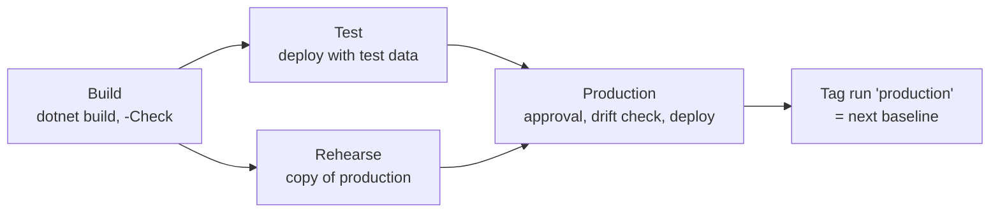

# Pipeline and deployment

Build once, deploy the same artifact everywhere. The dacpacs that reach production are byte for byte the
ones that were tested, and every deployment is a script run, not a manual step.



The sample is an Azure DevOps pipeline, [pipelines/database.yml](../pipelines/database.yml), with three
templates. Everything it does is in the PowerShell scripts, so moving it to GitHub Actions or another
system means rewriting the YAML, not the logic.

## Build

[build-dacpacs.yml](../pipelines/templates/build-dacpacs.yml):

1. `dotnet build database/build.proj -c Release -p:Version=$(Build.BuildNumber)` builds every project.
   The build number ends up in the dacpac metadata.
2. `New-MigrationScripts.ps1 -Check` and `Update-ColumnDescriptions.ps1 -Check -DacpacPath …` fail the
   build when a generated file is stale or a description is missing.
3. The artifact gets the dacpacs (flat, in `dacpacs/`) and the files the deployment needs, in the same
   layout as the repository: `database/environments.json`, `database/publish/`, `database/cdc/`, and
   `scripts/` with `lib/` and `schemas/`. The scripts find their defaults relative to their own folder,
   so they run unchanged from a checkout or from the artifact.

The pull request build runs the same template, without the deployment stages.

## Deploy

[deploy-database.yml](../pipelines/templates/deploy-database.yml) is a deployment job on an Azure DevOps
environment, so approvals and checks on that environment apply. It runs
[Publish-Database.ps1](../scripts/Publish-Database.ps1) twice:

1. **Plan** with `-WhatIf`: SqlPackage writes the deploy report (`Schema.deployreport.xml`) and the
   change script of every step, and blockers are printed as warnings. Nothing is changed.
2. **Deploy**: the same steps, and this time they are published. The schema step writes the deploy
   report again (the migrations may have changed things since the plan), and a blocker stops the
   deployment before the schema is touched.

The reports are published as an artifact even when the job fails, so the reason is one click away.

### Blockers

`Get-DeployReportBlocker` in [DeployReport.ps1](../scripts/lib/DeployReport.ps1) reads the deploy report
and stops on:

| In the report | Why it blocks |
|---|---|
| A `DataIssue` alert | A column or table with rows would be dropped, or a column would become narrower. |
| A `TableRebuild` operation | SqlPackage would copy the table into a new one: locks, log growth, broken CDC. |

The [publish profile](../database/publish/Shop.Database.publish.xml) blocks the same things a second
time (`BlockOnPossibleDataLoss`, `AllowTableRecreation=False`), but the report check fails earlier, with
a readable message, and also under `-WhatIf`.

### The publish profile

Only the schema dacpac uses the profile. Each setting is deliberate:

| Setting | Value | Why |
|---|---|---|
| `BlockOnPossibleDataLoss` | `True` | Data loss is never a side effect; see [breaking changes](breaking-changes.md). |
| `AllowTableRecreation` | `False` | No silent table rebuilds. |
| `IgnoreColumnOrder` | `True` | A column added in the middle of a table in the project must not rebuild it. |
| `DropObjectsNotInSource` | `True` | The project is the desired state. A manual index is dropped (and reported by the drift check first). |
| `DoNotDropObjectTypes` | Users, roles, permissions, credentials, … | Security is managed by the platform (users for managed identities, role memberships), not by the project. |
| `ScriptDatabaseOptions` | `False` | Collation, compatibility level and the like belong to the infrastructure code. |
| `GenerateSmartDefaults` | `False` | A new `NOT NULL` column without a default must fail, not get an invented value. |
| `IncludeTransactionalScripts` | `True` | The generated change script runs in a transaction where SQL Server allows it. |
| `DoNotAlterChangeDataCaptureObjects` | `True` | Capture instances are managed by their owner; see [CDC](cdc-and-schema-changes.md). |
| `IgnoreSensitivityClassifications` | `True` | Data classification is owned by a governance team; see [classification](column-descriptions-and-data-classification.md#data-classification). |

The script-only dacpacs (migrations, seeds, test data, DropAll) are published without the profile and
with explicit `DropObjectsNotInSource=False` and `ScriptDatabaseOptions=False`. They have no model:
published with the schema's profile, SqlPackage would drop every object that is not in their empty
model, and with the default `ScriptDatabaseOptions=True` they could reset database options to the
project defaults. Stating both explicitly keeps a future profile change from reaching them.

### Drift

A database that was changed by hand — a hotfix index, a column altered in the portal — differs from what
the pipeline thinks it deployed. The next deployment silently undoes it, or fails on it.

With `checkDrift: true` (production in the sample) the deploy job downloads the artifact of the last run
tagged `production`, and `Publish-Database.ps1 -DriftBaselineDacpac … -FailOnDrift` first compares the
database with that schema dacpac. Any difference stops the deployment and is listed. Then either bring
the change into the project, or accept that the deployment will undo it and run without the check once.

After a successful production deployment the `TagRelease` job tags the run `production`. That artifact is
the baseline for the next drift check and the next [rehearsal](schema-rehearsal.md).

### Retries

The deploy step has `retryCountOnTaskFailure: 1`. A transient failure — a failover, a scaling operation,
a dropped connection — is worth one more attempt, and a retry is safe: migrations are recorded in the
same transaction as their changes, seeds are `MERGE` statements, and the schema step compares again.
Do not raise the count to hide real failures.

## Identity and permissions

No passwords. The AzureCLI task signs in with the service connection (use workload identity federation),
and the scripts ask the Azure CLI for an access token for Azure SQL
(`az account get-access-token --resource https://database.windows.net/`), which SqlPackage gets as
`/AccessToken`. The token is masked in the logs by `Invoke-SqlPackage`.

| Identity | Needs | Scope |
|---|---|---|
| Test deploy | A database user (`CREATE USER [name] FROM EXTERNAL PROVIDER`) with `db_owner`, or `db_ddladmin` + `db_datareader` + `db_datawriter` + `VIEW DEFINITION` | The test database |
| Production deploy | The same | The production database |
| Rehearsal | Create, read and delete databases on the server (for example the *SQL DB Contributor* role); a database user in production (the copy inherits it) | The production server |

Notes:

- `db_ddladmin` is enough for most schema changes; extended properties, `ALTER ANY SCHEMA` and some
  options need more. Start with `db_owner` on a dedicated identity per environment, and narrow it when
  you know what your deployments do.
- Keep the rehearsal identity separate from the deploy identity: it can delete databases on the
  production server. The [rehearsal scripts](schema-rehearsal.md#safety-guards) only delete databases
  whose name and tag mark them as rehearsal copies, but the role itself is broader.
- Database users are not in the project (`DoNotDropObjectTypes`), so creating them is part of the
  infrastructure code or a one-time setup, not of the dacpac.
- A firewall: the hosted agent needs access to the server. Prefer a private endpoint with self-hosted
  agents in the network; otherwise allow Azure services during the deployment only.

## Running it elsewhere

Locally, against a container or a developer database:

```powershell
./scripts/Publish-Database.ps1 -ArtifactPath ./database -Environment Development `
    -ConnectionString 'Server=localhost,1433;Initial Catalog=Shop;User ID=sa;Password=<your password>;TrustServerCertificate=True' `
    -BuildNumber local -AllowIncompatiblePlatform -WhatIf
```

`-AllowIncompatiblePlatform` is needed because the projects target Azure SQL Database and a container is
SQL Server. See [getting started](getting-started.md).
